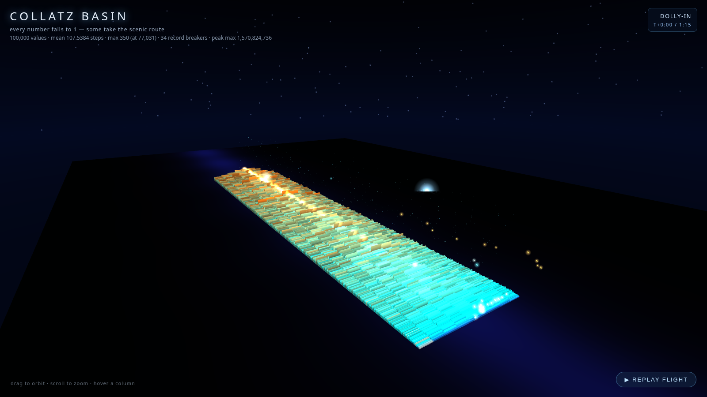

# Collatz Basin — 100,000 numbers falling into 1

An interactive WebGL visualization of the Collatz conjecture: 100,000 starting
values rendered as trajectories "falling" into 1, with a step-count terrain and
record-breaker highlights.

- **Open it:** [`collatz-basin.html`](collatz-basin.html) — single self-contained file.
- **Dataset:** computed with Python (stdlib only) into a live-formula Excel
  workbook (`collatz_basin.xlsx`), recalculated headlessly with LibreOffice,
  then exported to JSON that feeds the renderer. The workbook is the source of
  truth; the HTML only draws it.
- **Logic tests:** `test_logic.js` exercises the pure trajectory/terrain logic
  headlessly in node before the build inlines it.

## Verified stats (from the recalculated workbook)

| stat | value |
|---|---|
| values | 100,000 |
| mean stopping steps | 107.54 |
| max steps | 350 (at 77,031) |
| record breakers | 34 |
| max peak | 1,570,824,736 |

