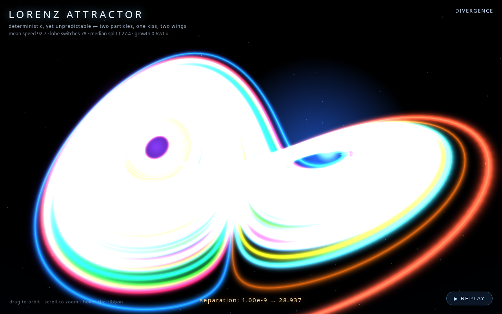

# Lorenz Attractor — two particles, one kiss, two wings

Two particles start at the same point, separated by a whisper (ε), and end up on
opposite wings of the attractor — deterministic chaos you can watch. The page
renders hero and sister trajectories, split moments, and a divergence readout.

- **Open it:** [`lorenz-attractor.html`](lorenz-attractor.html) — single self-contained file.
- **Dataset:** Lorenz system σ=10, ρ=28, β=8/3, RK4, dt=0.005, computed in
  Python (stdlib + openpyxl) into a live-formula workbook (`lorenz.xlsx`:
  Hero 30k steps, Sisters 12 trajectories, Divergence 20 clones ε=1e-9..1e-4,
  Stats), recalculated headlessly with LibreOffice, exported to JSON.
- **Integrator validation:** probe.py + Benettin tangent estimate λ ≈ 0.98
  (literature 0.9056); dt=0.005 tracks dt=0.001 to t≈25 — chaos saturation
  beyond that is the point of the dataset.

## Verified stats

| stat | value |
|---|---|
| z-range (hero) | [0.962, 47.834] |
| lobe switches (t<150) | 78 |
| median split time (20 clones) | 27.35 |
| mean divergence growth rate | 0.624 |

Note: an x-directed perturbation first *contracts* (∂ẋ/∂x = −σ = −10) before
aligning with the stretching direction — split times are real physics, not a bug.

