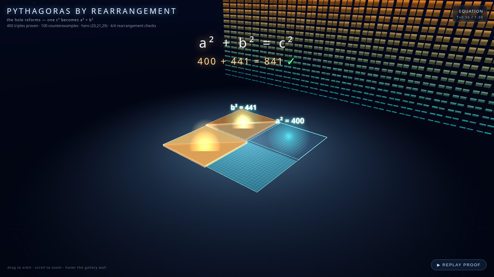

# Pythagoras by Rearrangement — the hole reforms

A proof-without-words made interactive: two configurations of the same four
right triangles inside an (a+b)² square, animated through a slide rearrangement
while the uncovered hole reforms — a visual `a² + b² = c²`.

- **Open it:** [`pythagoras.html`](pythagoras.html) — single self-contained file.
- **Dataset:** 400 Pythagorean triples and 100 deliberate counterexamples are
  verified in Python (`verify.py`) and in a live-formula workbook
  (`pythagoras.xlsx`); the HTML draws from the exported JSON.
- **Logic tests:** `test_logic.js` checks the pure geometry/rearrangement logic
  headlessly in node.

## Verified stats

| stat | value |
|---|---|
| triples proven | 400 (0 failed) |
| counterexamples with nonzero a²+b²−c² delta | 100/100 |
| hero square area (a+b)² | 1681 = Config A total = Config B total |

